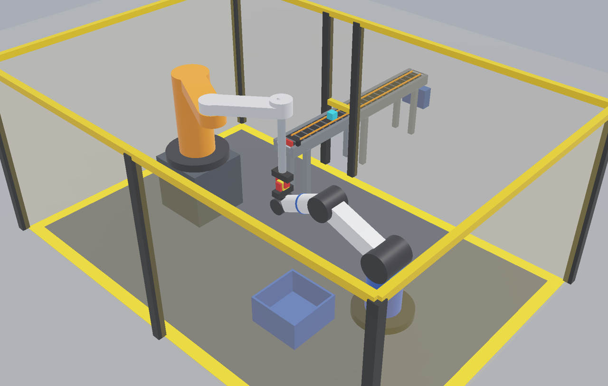
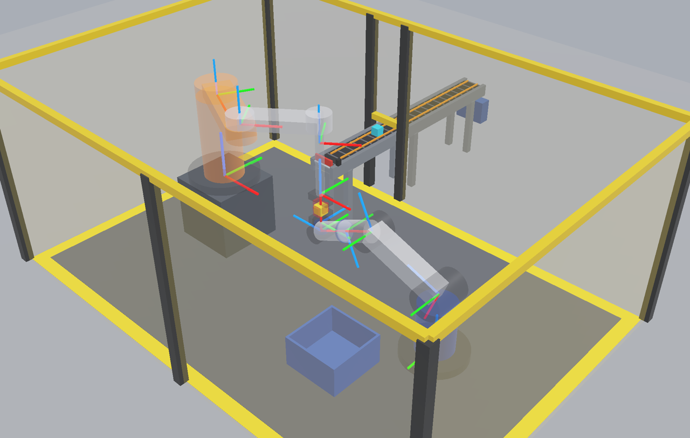
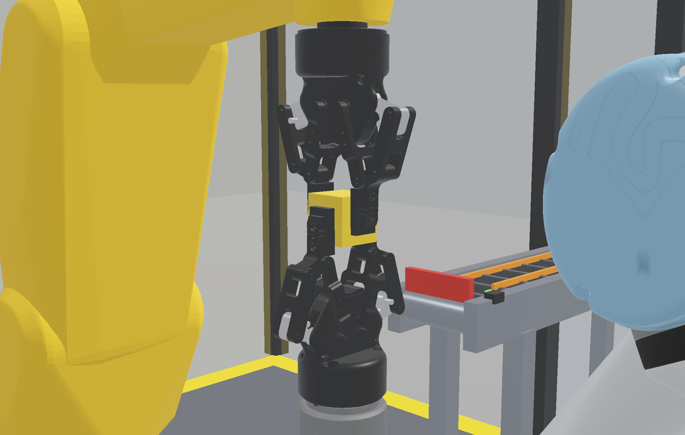
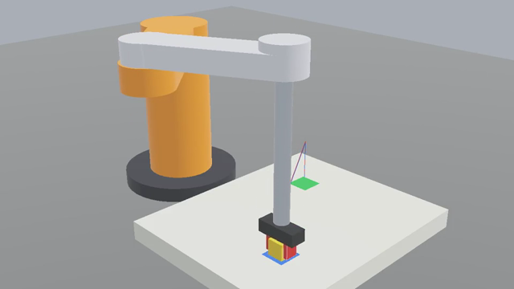
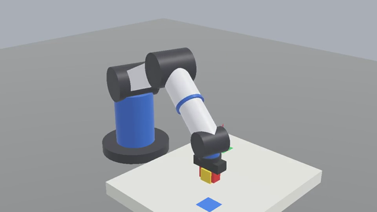
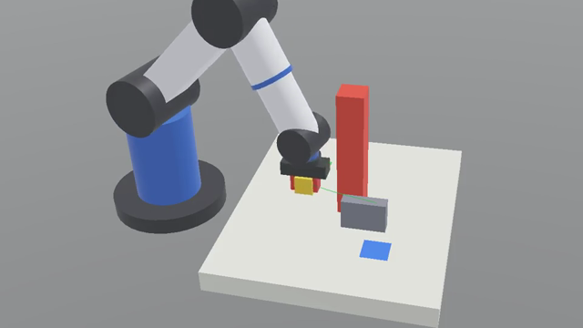

**English** · [Français](README.md)

# SCARA + 6-axis robot cell with an in-air hand-over, in Webots

A 4-axis SCARA and a 6-axis arm pass a 50 g cube **directly from gripper to gripper, in mid-air**.
A conveyor brings the cubes one by one against an end stop fitted with a through-beam sensor; a PLC
(the supervisor controller of the conveyor) starts the cycle of both robots when a cube is present. The
6-axis arm flips the cube in the air and drops it into the output bin. Throughput: **one cube every 14.4 s**.
The cell is built in [Webots](https://cyberbotics.com) R2025a (open-source simulator, Apache 2.0);
both robots, the conveyor, the bin and the fence are parameterised PROTOs (`protos/`).



Video of one cycle: [`docs/robot_cell.mp4`](docs/robot_cell.mp4) — with the joint frames:
[`docs/robot_cell_joint_frames.mp4`](docs/robot_cell_joint_frames.mp4).

## Open it

- **In the browser:** [`site/`](site/) holds an interactive 3D (HTML5) animation of one cycle exported by
  Webots (orbit, zoom and scrub the timeline). It is published on GitHub Pages from the `gh-pages` branch
  (`git subtree push --prefix site origin gh-pages`) at
  [nicolasbrochen.github.io/robot-cell-webots](https://nicolasbrochen.github.io/robot-cell-webots/).
- **In Webots:** this repository *is* the Webots project folder (`worlds/`, `protos/`, `controllers/`,
  `motions/`). Open [`worlds/robot_cell.wbt`](worlds/robot_cell.wbt) and run the simulation: the cell starts
  on its own (no external tool needed). [`worlds/robot_cell_plain.wbt`](worlds/robot_cell_plain.wbt) is the
  same cell with opaque robots and no joint frames.

## What is in the cell

| Component | Description |
|---|---|
| Infeed conveyor | 1.12 m belt at 0.15 m/s, top at 0.35 m, side guides, end stop (`BeltConveyor.proto`) |
| Through-beam sensor | `presence_butee`, a distance sensor aimed across the belt at the end stop |
| SCARA | `scara` on a 0.30 m pedestal, links L1 = 0.40 m / L2 = 0.30 m, 0.15 m vertical stroke (`Scara4Axis.proto`) |
| 6-axis arm | `arm6`, spherical wrist, shoulder at 0.30 m, upper arm 0.35 m / forearm 0.30 m (`Arm6Dof.proto`) |
| Grippers | 2 symmetric parallel fingers per robot (linear motors, 10 N), palm with a collision volume |
| Cubes | 40 mm, 50 g, 3 in circulation (recycled from the bin back to the conveyor) |
| Output bin | 0.25 × 0.25 × 0.14 m (`OutputBin.proto`) |
| Fence | transparent panels, yellow rails, opening for the conveyor (`SafetyFence.proto`) |

### The robots (`protos/Scara4Axis.proto`, `protos/Arm6Dof.proto`)

Our own procedural models (no vendor CAD), fully simulated in dynamics (masses, inertias, gravity).
Common fields: `translation`, `rotation`, `name`, `controller`, `controllerArgs`, `initialPosition`
(joint positions at load time), `transparency` and `showJointFrames` (X red / Y green / Z blue frame on
every joint, moving with it).



| Robot | Joints | Kinematics |
|---|---|---|
| SCARA | `joint1`, `joint2` (z), `joint3` (translation −z), `joint4` (gripper yaw) | analytic IK, elbow-left branch; `joint4 = −(joint1 + joint2)` keeps the gripper aligned with the x axis |
| 6-axis | `joint1` (z), `joint2`, `joint3`, `joint5` (y), `joint4`, `joint6` (x) | product of exponentials, numeric IK (damped least squares) on the gripper position **and** orientation |

### The hand-over



- The SCARA holds the cube from above, fingers on the ±x faces, over its upper half.
- The 6-axis arm comes **from below**, gripper pointing up, fingers on the ±y faces over the full height of
  the cube, palm 1.5 mm under the cube: when the SCARA lets go, the cube settles on the palm.
  The fingers of the two grippers never cross (different faces, 5 mm clearance).
- The 6-axis arm then flips the cube 180° in the air (gripper pointing down) and drops it into the bin.
- The fingers close 0.5 mm beyond contact: the cube stays centred within ±0.5 mm and both fingers stay
  symmetric.

### The PLC (`controllers/conveyor`) and the robots (`controllers/cell_robot`)

| Message | Channel | Direction | Meaning |
|---|---|---|---|
| `READY scara` / `READY arm6` | 2 | robot → PLC | the robot waits in its start pose |
| `START` | 1 | PLC → robots | a cube has been at the end stop for 0.3 s and both robots are ready |

- Both robots receive `START` on the same simulation step: their cycles are synchronised. Each one plays
  its `motions/*_cell.motion` file (361 poses, one every 40 ms) and then sends `READY` again.
- The conveyor only drives cubes lying flat more than 6 mm before the stop (a cube at the stop or lifted by
  a gripper is never pulled), releases a cube when the belt and the stop are empty, and recycles the cubes
  that have been still in the bin for 1.5 s.
- If the infeed stops, the robots stay idle and wait (checked by the tests).

## Tests

```sh
python3 -m venv .venv && .venv/bin/pip install -r requirements.txt   # numpy, for the tools
.venv/bin/python tools/check_kin.py      # kinematics: IK -> FK closure, motions through the key points
.venv/bin/python tools/gen_motions.py    # regenerates the cycles + robot clearance, joint speeds
tools/run_tests.sh                       # tests/*.test.json scenarios in headless Webots (--batch --mode=fast --no-rendering)
tools/perturb.sh                         # the tests must FAIL on 4 deliberately broken versions
tools/run_examples.sh                    # checks the example worlds
```

| Scenario | Checks |
|---|---|
| `transfer` | ≥ 5 cubes delivered in 75 s, no cube on the floor, no robot contact with anything but a cube |
| `handover` | cube centred within ≤ 1.5 mm in both grippers, slip ≤ 3 mm in the 6-axis gripper, never inside the palm |
| `presence-interlock` | no `START` without a cube at the end stop; robots idle when the infeed runs dry |
| `endurance` | 20 consecutive cycles (5 min of production) without a missed pick, a drop or a collision |

| Mutation (`tools/perturb.sh`) | Caught by |
|---|---|
| the PLC ignores the through-beam sensor | `presence-interlock` |
| the 6-axis arm grips only the lower half of the cube (the cube slips into the gripper) | `handover` |
| the conveyor keeps driving the cube at the end stop (cube torn out of the gripper) | `transfer` |
| the grippers do not squeeze | `transfer` |

Detailed reports are written to `tests/results/` (ignored by git).

## Rebuilding

| Script | Does |
|---|---|
| `tools/cell_layout.py` | dimensions of the cell (single source of truth) |
| `tools/kinematics.py` | forward / inverse kinematics of both robots, sphere collision models |
| `tools/gen_motions.py` | computes the two synchronised cycles → `motions/scara_cell.motion`, `motions/arm6_cell.motion` |
| `tools/build_world.py` | writes `worlds/robot_cell.wbt` (`--plain`: opaque robots, no frames) |
| `tools/build_examples.py` | writes the example worlds 02 to 04 |
| `tools/build_site.sh` | re-records the HTML5 animation of `site/` (one cycle, headless Webots) |

## Examples

The steps that led to the cell, in the same project (examples 02 to 04: same PROTOs, `motion_player`
controller; example 01: `scara_trajectory` controller):

| World | | |
|---|---|---|
| `example_01_scara_trajectory.wbt` | SCARA following a 3D figure-8 by inverse kinematics; planned path in green, actual path drawn live in red | |
| `example_02_scara_pick_place.wbt` | SCARA: pick and place of a 50 g cube from A to B and back |  |
| `example_03_arm6_pick_place.wbt` | same cycle with the 6-axis arm, gripper kept vertical |  |
| `example_04_arm6_obstacles.wbt` | path around a 30 cm pillar and a low wall: A* on a 1 cm grid with the whole-arm collision model, smoothing, 32 mm minimum clearance |  |

Videos in [`docs/examples/`](docs/examples/). Generators in `tools/examples/`.

## Built with

The cell was built and debugged by driving Webots from Claude Code through the
[webotMCP](https://github.com/MHasaan/webotMCP) MCP server (scene inspection, node creation, screenshots,
trajectory tracking, video recording). The repository does not depend on it: everything runs with Webots
alone.

## Licences and disclaimer

- The robot, conveyor, bin and fence models are our own procedural models; no vendor CAD is used.
- [Webots](https://github.com/cyberbotics/webots) is distributed under the Apache 2.0 licence; the
  animation in `site/` loads the Webots player from `cyberbotics.com`.
- Educational simulation project: the dimensions, masses and forces are not those of real industrial
  equipment.
