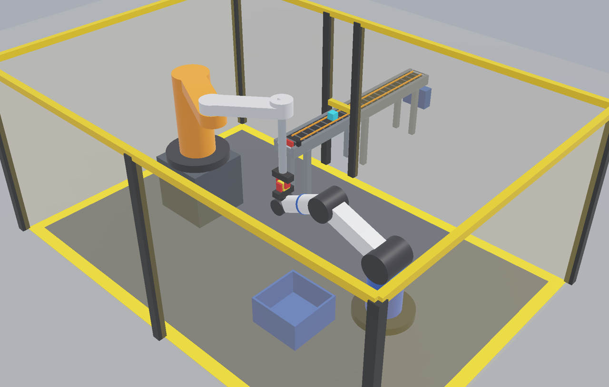
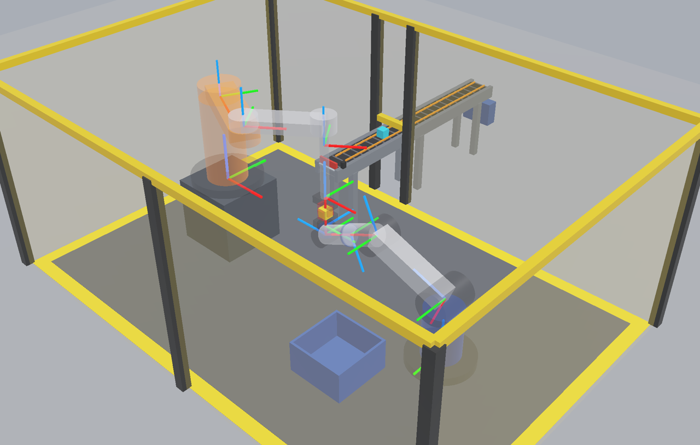
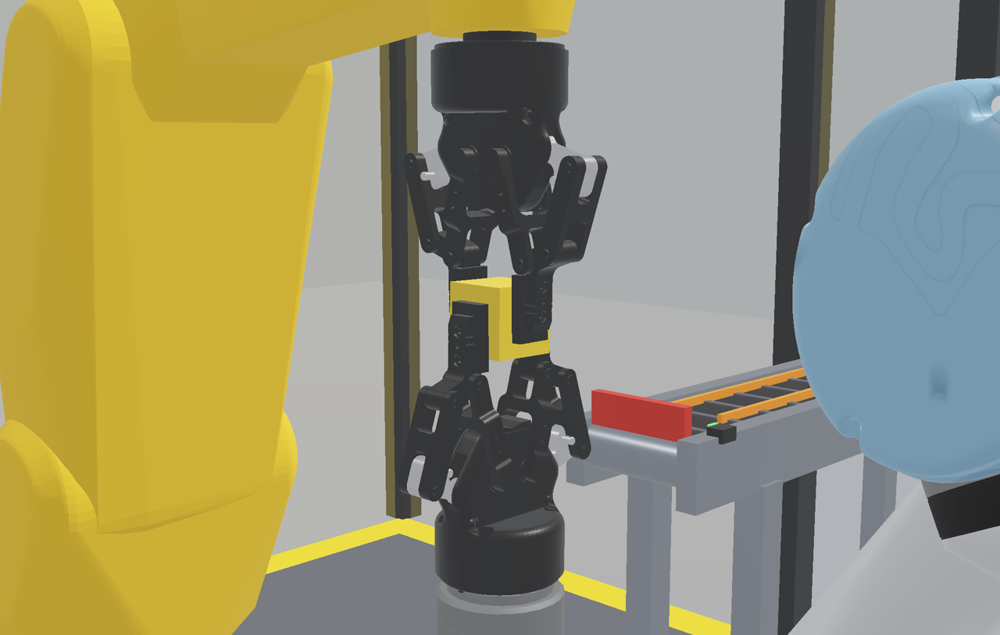
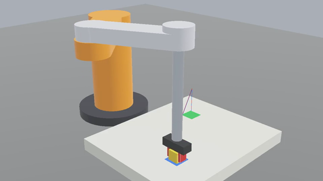
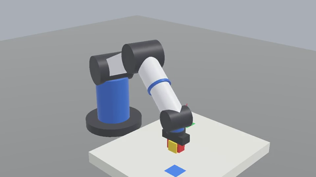
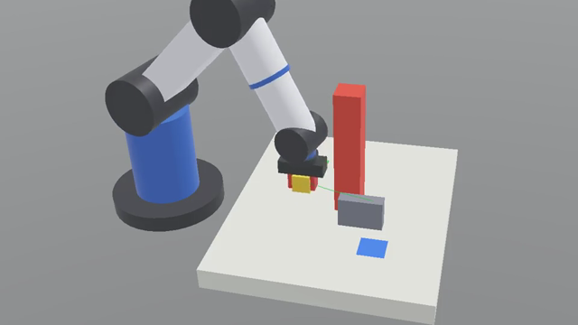

[English](README.en.md) · **Français**

# Cellule robotisée SCARA + bras 6 axes avec passage de main, dans Webots

Un SCARA 4 axes et un bras 6 axes se passent un cube de 50 g **directement de pince à pince, en l'air**.
Un convoyeur amène les cubes un par un contre une butée équipée d'une barrière optique ; un automate
(contrôleur superviseur du convoyeur) lance le cycle des deux robots quand un cube est présent. Le 6 axes
retourne le cube en l'air et le lâche dans le bac de sortie. Cadence : **un cube toutes les 14,4 s**.
La cellule est construite dans [Webots](https://cyberbotics.com) R2025a (simulateur libre, Apache 2.0) ;
les deux robots, le convoyeur, le bac et la clôture sont des PROTO paramétrables (`protos/`).



Vidéo d'un cycle : [`docs/robot_cell.mp4`](docs/robot_cell.mp4) — avec les repères des joints :
[`docs/robot_cell_joint_frames.mp4`](docs/robot_cell_joint_frames.mp4).

## L'ouvrir

- **Dans le navigateur :** [`site/`](site/) contient une animation 3D interactive (HTML5) d'un cycle,
  exportée par Webots (on peut tourner autour, zoomer et parcourir la ligne de temps). Publiée sur
  GitHub Pages depuis la branche `gh-pages` (`git subtree push --prefix site origin gh-pages`), elle
  s'ouvre à l'adresse [nicolasbrochen.github.io/robot-cell-webots](https://nicolasbrochen.github.io/robot-cell-webots/).
- **Dans Webots :** ce dépôt *est* le dossier du projet Webots (`worlds/`, `protos/`, `controllers/`,
  `motions/`). Ouvrir [`worlds/robot_cell.wbt`](worlds/robot_cell.wbt) et lancer la simulation : la cellule
  démarre seule (aucun outil externe nécessaire). [`worlds/robot_cell_plain.wbt`](worlds/robot_cell_plain.wbt)
  est la même cellule avec des robots opaques et sans repères.

## Ce que contient la cellule

| Élément | Description |
|---|---|
| Convoyeur d'entrée | bande de 1,12 m à 0,15 m/s, plateau à 0,35 m, guides latéraux, butée en bout de bande (`BeltConveyor.proto`) |
| Barrière optique | `presence_butee`, capteur de distance qui vise la butée en travers de la bande |
| SCARA | `scara` sur socle de 0,30 m, bras L1 = 0,40 m / L2 = 0,30 m, course verticale 0,15 m (`Scara4Axis.proto`) |
| Bras 6 axes | `arm6`, poignet sphérique, épaule à 0,30 m, bras 0,35 m / avant-bras 0,30 m (`Arm6Dof.proto`) |
| Pinces | 2 doigts parallèles symétriques par robot (moteurs linéaires, 10 N), paume avec volume de collision |
| Cubes | 40 mm, 50 g, 3 en circulation (recyclés du bac vers le convoyeur) |
| Bac de sortie | 0,25 × 0,25 × 0,14 m (`OutputBin.proto`) |
| Clôture | panneaux transparents, lisses jaunes, ouverture pour le convoyeur (`SafetyFence.proto`) |

### Les robots (`protos/Scara4Axis.proto`, `protos/Arm6Dof.proto`)

Modèles procéduraux maison (aucune CAO constructeur), entièrement simulés en dynamique (masses, inerties,
gravité). Champs communs : `translation`, `rotation`, `name`, `controller`, `controllerArgs`,
`initialPosition` (positions articulaires au chargement), `transparency` et `showJointFrames`
(repère X rouge / Y vert / Z bleu sur chaque articulation, il suit le mouvement).



| Robot | Articulations | Cinématique |
|---|---|---|
| SCARA | `joint1`, `joint2` (z), `joint3` (translation −z), `joint4` (lacet de la pince) | IK analytique, coude à gauche ; `joint4 = −(joint1 + joint2)` garde la pince alignée sur l'axe x |
| 6 axes | `joint1` (z), `joint2`, `joint3`, `joint5` (y), `joint4`, `joint6` (x) | produit d'exponentielles, IK numérique (moindres carrés amortis) sur la position **et** l'orientation de la pince |

### Le passage de main



- Le SCARA tient le cube par le haut, doigts sur les faces ±x, sur sa moitié supérieure.
- Le 6 axes arrive **par en dessous**, pince vers le haut, doigts sur les faces ±y, sur toute la hauteur
  du cube, la paume 1,5 mm sous le cube : quand le SCARA lâche, le cube se pose sur la paume.
  Les doigts des deux pinces ne se croisent jamais (faces différentes, 5 mm de jeu).
- Le 6 axes retourne ensuite le cube de 180° en l'air (pince vers le bas) et le lâche dans le bac.
- Les doigts se ferment à 0,5 mm au-delà du contact : le cube reste centré à ±0,5 mm et les deux doigts
  restent symétriques.

### L'automate (`controllers/conveyor`) et les robots (`controllers/cell_robot`)

| Message | Canal | Sens | Signification |
|---|---|---|---|
| `READY scara` / `READY arm6` | 2 | robot → automate | le robot attend dans sa pose de départ |
| `START` | 1 | automate → robots | un cube est en butée depuis 0,3 s et les deux robots sont prêts |

- Les deux robots reçoivent `START` au même pas de simulation : leurs cycles sont synchronisés.
  Chacun joue son fichier `motions/*_cell.motion` (361 poses, une toutes les 40 ms) puis renvoie `READY`.
- Le convoyeur n'entraîne que les cubes posés à plat à plus de 6 mm de la butée (un cube en butée ou
  soulevé par la pince n'est jamais tiré), libère un cube quand la bande et la butée sont vides, et recycle
  les cubes immobiles dans le bac depuis 1,5 s.
- Si l'alimentation s'arrête, les robots restent immobiles en attente (vérifié par les tests).

## Tests

```sh
python3 -m venv .venv && .venv/bin/pip install -r requirements.txt   # numpy, pour les outils
.venv/bin/python tools/check_kin.py      # cinématique : fermeture IK -> FK, passage des mouvements aux points clés
.venv/bin/python tools/gen_motions.py    # régénère les cycles + distance entre robots, vitesses articulaires
tools/run_tests.sh                       # scénarios tests/*.test.json dans Webots sans affichage (--batch --mode=fast --no-rendering)
tools/perturb.sh                         # les tests doivent ÉCHOUER sur 4 versions volontairement cassées
tools/run_examples.sh                    # vérifie les mondes d'exemple
```

| Scénario | Vérifie |
|---|---|
| `transfer` | ≥ 5 cubes livrés en 75 s, aucun cube au sol, aucun contact d'un robot avec autre chose qu'un cube |
| `handover` | cube centré à ≤ 1,5 mm dans les deux pinces, glissement ≤ 3 mm dans la pince du 6 axes, jamais dans la paume |
| `presence-interlock` | aucun `START` sans cube en butée ; robots immobiles quand l'alimentation est coupée |
| `endurance` | 20 cycles d'affilée (5 min de production) sans prise ratée, chute ni collision |

| Mutation (`tools/perturb.sh`) | Détectée par |
|---|---|
| l'automate ignore la barrière optique | `presence-interlock` |
| le 6 axes ne prend que la moitié basse du cube (cube qui glisse dans la pince) | `handover` |
| le convoyeur entraîne encore le cube en butée (cube arraché de la pince) | `transfer` |
| les pinces ne serrent pas | `transfer` |

Les rapports détaillés sont écrits dans `tests/results/` (ignoré par git).

## Reconstruire

| Script | Rôle |
|---|---|
| `tools/cell_layout.py` | cotes de la cellule (source unique) |
| `tools/kinematics.py` | cinématique directe / inverse des deux robots, modèles de collision par sphères |
| `tools/gen_motions.py` | calcule les deux cycles synchronisés → `motions/scara_cell.motion`, `motions/arm6_cell.motion` |
| `tools/build_world.py` | écrit `worlds/robot_cell.wbt` (`--plain` : robots opaques sans repères) |
| `tools/build_examples.py` | écrit les mondes d'exemple 02 à 04 |
| `tools/build_site.sh` | réenregistre l'animation HTML5 de `site/` (un cycle, Webots sans interface) |

## Exemples

Les étapes qui ont mené à la cellule, dans le même projet (exemples 02 à 04 : mêmes PROTO, contrôleur `motion_player` ; exemple 01 : contrôleur `scara_trajectory`) :

| Monde | | |
|---|---|---|
| `example_01_scara_trajectory.wbt` | SCARA qui suit un « 8 » en 3D par cinématique inverse ; trajectoire prévue en vert, trajectoire réelle tracée en direct en rouge | |
| `example_02_scara_pick_place.wbt` | SCARA : prise et dépose d'un cube de 50 g de A vers B puis retour |  |
| `example_03_arm6_pick_place.wbt` | même cycle avec le bras 6 axes, pince maintenue verticale |  |
| `example_04_arm6_obstacles.wbt` | contournement d'un pilier de 30 cm et d'un muret : A* sur une grille de 1 cm avec le modèle de collision du bras entier, lissage, 32 mm de dégagement mini |  |

Vidéos dans [`docs/examples/`](docs/examples/). Générateurs dans `tools/examples/`.

## Réalisé avec

La cellule a été construite et mise au point en pilotant Webots depuis Claude Code via le serveur MCP
[webotMCP](https://github.com/MHasaan/webotMCP) (inspection de la scène, création des nœuds, captures,
suivi des trajectoires, enregistrement des vidéos). Le dépôt n'en dépend pas : tout s'exécute avec
Webots seul.

## Licence et avertissement

- Les modèles des robots, du convoyeur, du bac et de la clôture sont des modèles procéduraux maison ;
  aucune CAO constructeur n'est utilisée.
- [Webots](https://github.com/cyberbotics/webots) est distribué sous licence Apache 2.0 ; l'animation de
  `site/` charge le lecteur Webots depuis `cyberbotics.com`.
- Projet de simulation à but pédagogique : les dimensions, masses et efforts ne sont pas ceux d'un
  équipement industriel réel.
