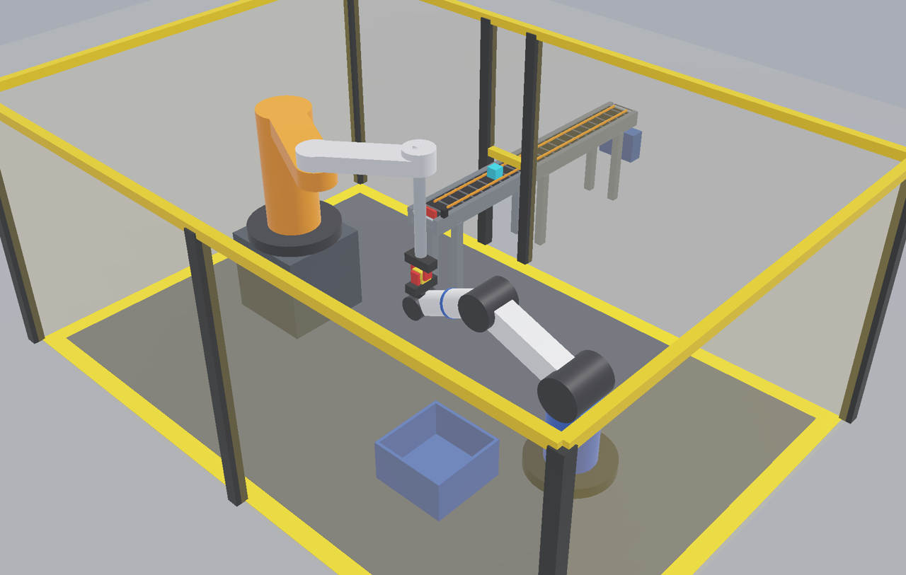
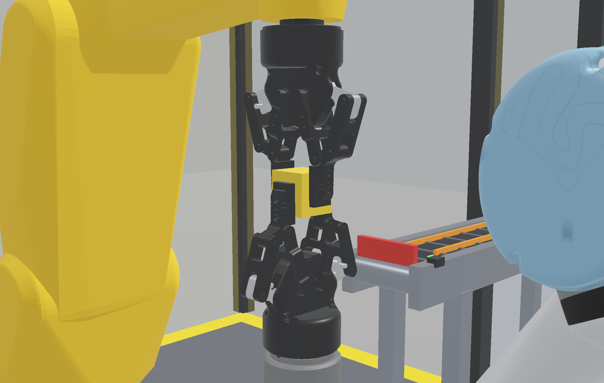
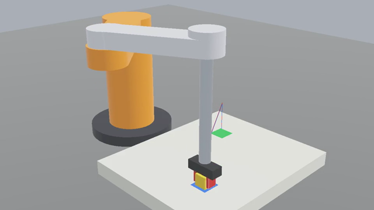
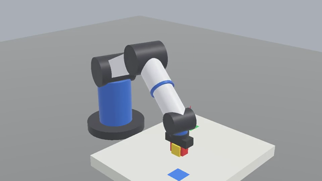
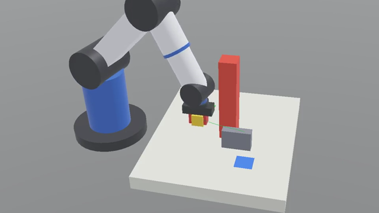

**English** · [Français](README.fr.md)

# FANUC + UR5e robot cell with an in-air hand-over, in Webots

A **FANUC LR Mate 200iD** and a **Universal Robots UR5e**, both fitted with a **Robotiq 2F-85** gripper,
pass a 50 g cube **directly from gripper to gripper, in mid-air**. A conveyor brings the cubes one by one
against an end stop fitted with a through-beam sensor; a PLC (the supervisor controller of the conveyor)
starts both robot cycles when a cube is present. The UR5e flips the cube in the air and drops it into the
output bin. Throughput: **one cube every 14.4 s**. Built in [Webots](https://cyberbotics.com) R2025a.



Video of one cycle: [`docs/robot_cell.mp4`](docs/robot_cell.mp4). The first version of the cell, with our
own SCARA and 6-axis models, is tagged [`v1.0`](../../tree/v1.0).

## Open it

- **In the browser:** [`site/`](site/) holds an interactive 3D (HTML5) animation of one cycle exported by
  Webots (orbit, zoom and scrub the timeline), published on GitHub Pages from the `gh-pages` branch
  (`git subtree push --prefix site origin gh-pages`) at
  [nicolasbrochen.github.io/robot-cell-webots](https://nicolasbrochen.github.io/robot-cell-webots/).
- **In Webots:** this repository *is* the Webots project folder. Open
  [`worlds/robot_cell.wbt`](worlds/robot_cell.wbt) and run the simulation: the cell starts on its own. The
  UR5e and Robotiq PROTOs are downloaded from the Webots GitHub repository on first use (Internet access
  needed once, then cached by Webots).

## What is in the cell

| Component | Source | Role |
|---|---|---|
| FANUC LR Mate 200iD | [`protos/FanucLrMate200iD.proto`](protos/FanucLrMate200iD.proto), converted from [ros-industrial/fanuc](https://github.com/ros-industrial/fanuc) with urdf2webots | picks the cube at the end stop and presents it at the hand-over point |
| Universal Robots UR5e | official Webots PROTO, on a 2 cm plate | takes the cube from below, flips it, drops it into the bin |
| 2 × Robotiq 2F-85 | official Webots PROTO, mounted in the toolSlots | two-finger adaptive grippers (85 mm stroke) |
| Infeed conveyor | [`protos/BeltConveyor.proto`](protos/BeltConveyor.proto) | 1.12 m belt at 0.15 m/s, side guides, end stop, through-beam sensor 7 mm above the belt |
| Cubes | world | 40 mm, 50 g, 3 in circulation (recycled from the bin back to the conveyor) |
| Mobile cell cart | [`protos/MobilePlexiCell.proto`](protos/MobilePlexiCell.proto) | industrial mobile workstation constructed from T-slotted aluminum extrusion profiles (45×45 mm / 40×40 mm) with corner gusset brackets, 4 caster wheels with brakes, lower shelf hosting both robot power supplies / controllers (FANUC R-30iB Mate Plus & UR5e Control Box) and Teach Pendants (FANUC iPendant & UR PolyScope tablet), tooling tabletop, transparent plexiglass enclosure (6 mm polycarbonate), front hinged door with interlock, and emergency stop console |
| Output bin | [`protos/OutputBin.proto`](protos/OutputBin.proto) | |

### The hand-over



- The FANUC holds the cube from above, pads on the ±x faces, over its upper 30 mm.
- The UR5e comes **from below**, gripper pointing up, pads on the ±y faces, over the lower 30 mm. The
  22 mm pads of the two grippers sit on different faces and never touch.
- The UR5e closes, the FANUC opens and moves up 5 cm, then the UR5e flips the cube 180° in the air and
  drops it into the bin.
- Grasp depth calibrated in Webots (`tools/calibrate.sh`): with the cube centre 150 mm from the gripper
  origin, the fingers stop at 0.45 rad and the cube is held through a 10 cm lift.

### Kinematics

[`tools/kinematics_lib.py`](tools/kinematics_lib.py) models both arms as the chain of Webots joints read from
their PROTOs (axis, anchor, end-point pose), plus the Robotiq mount, with a numeric inverse kinematics
(damped least squares on position **and** orientation). `tools/calibrate.sh` drives both robots in Webots
through 31 random configurations: the model matches the simulator within **0.21 mm / 0.002°** (UR5e) and
**0.23 mm / 0.002°** (FANUC). The cycles stay within the joint limits (FANUC wrist J5: 0.31 rad margin)
and below 80 % of the motor speeds. The UR5e runs on the wrist branch with J4 (`wrist_1_joint`) rotated by
180° from the first IK solution.

### Physics notes (Webots Robotiq model)

- The finger motors of the Webots Robotiq2f85Gripper are limited to 0.1 N·m (a fixed value inside the
  official PROTO), far below the 20–235 N grip of the real gripper: the pad/cube friction is raised to 5
  to emulate it.
- ODE does not resist the rotation of the cube about the pad normal by default: during the flip the cube
  pivoted out of the UR5e gripper. A spinning friction (`rollingFriction 0 0 0.01`) is added to the
  pad/cube contacts.
- The two fingers of the Webots model are independent torque-limited motors (the real 2F-85 couples them
  mechanically), so they do not re-centre a cube already held by the other gripper: the conveyor keeps
  each cube pressed against the end stop so that the FANUC picks it centred.

### The PLC (`controllers/conveyor`) and the robots (`controllers/cell_robot`)

| Message | Channel | Direction | Meaning |
|---|---|---|---|
| `READY fanuc` / `READY ur5e` | 2 | robot → PLC | the robot has reached its waiting pose |
| `START` | 1 | PLC → robots | a cube has been at the end stop for 0.3 s and both robots are ready |

- Both robots receive `START` on the same simulation step and play their `motions/*_cell.motion` file
  (361 poses, one every 40 ms; 6 joints + 2 Robotiq fingers). Emitters and receivers sit in the toolSlots.
- At start-up the robots leave their zero pose through a safe intermediate pose (UR5e arm straight up)
  and report `READY` only once the waiting pose is actually reached.
- If the infeed stops, the robots stay idle and wait (checked by the tests).

## Tests

```sh
python3 -m venv .venv && .venv/bin/pip install -r requirements.txt   # numpy, for the tools
.venv/bin/python tools/check_kin.py      # IK -> FK closure, motions through the key points
.venv/bin/python tools/gen_motions.py    # regenerates the cycles + joint limits and speeds
tools/calibrate.sh                       # FK vs Webots (31 random poses per robot) + Robotiq grasp bench
tools/run_tests.sh                       # tests/*.test.json scenarios in headless Webots
tools/perturb.sh                         # the tests must FAIL on 5 deliberately broken versions
tools/run_examples.sh                    # checks the example worlds
```

| Scenario | Checks |
|---|---|
| `transfer` | ≥ 5 cubes delivered in 75 s, no cube on the floor, no robot contact with anything but a cube |
| `handover` | cube centred within 3 mm between the fingers and within 8 mm along the pads, no slip > 3 mm in either gripper |
| `presence-interlock` | no `START` without a cube at the end stop; robots idle when the infeed runs dry |
| `endurance` | 20 consecutive cycles (5 min of production) without a missed pick, a drop or a collision |

| Mutation (`tools/perturb.sh`) | Caught by |
|---|---|
| the PLC ignores the through-beam sensor | `presence-interlock` |
| the UR5e never closes at the hand-over | `transfer` |
| no spinning friction on the Robotiq pads | `transfer` |
| the conveyor no longer keeps the cube against the end stop | `handover` |
| the grippers do not squeeze | `transfer` |

## Rebuilding

| Script | Does |
|---|---|
| `tools/cell_layout.py` | dimensions of the cell, grasp depth and gripper commands (single source of truth) |
| `tools/kinematics_lib.py` | FK / IK of the UR5e and FANUC with their Robotiq |
| `tools/gen_motions.py` | computes the two synchronised cycles → `motions/fanuc_cell.motion`, `motions/ur5e_cell.motion` |
| `tools/build_world.py` | writes `worlds/robot_cell.wbt` |
| `tools/calibrate.sh` | validates the kinematics against Webots and measures the Robotiq grasp |
| `tools/build_site.sh` | re-records the HTML5 animation of `site/` (one cycle, headless Webots) |
| `tools/build_examples.py` | writes the example worlds 02 to 04 |

## Examples

The steps that led to the cell, with our own procedural robots (`protos/Scara4Axis.proto`,
`protos/Arm6Dof.proto`): example 01 uses the `scara_trajectory` controller, examples 02 to 04 the
`motion_player` controller.

| World | | |
|---|---|---|
| `example_01_scara_trajectory.wbt` | SCARA following a 3D figure-8 by inverse kinematics; planned path in green, actual path drawn live in red | |
| `example_02_scara_pick_place.wbt` | SCARA: pick and place of a 50 g cube from A to B and back |  |
| `example_03_arm6_pick_place.wbt` | same cycle with the 6-axis arm, gripper kept vertical |  |
| `example_04_arm6_obstacles.wbt` | path around a 30 cm pillar and a low wall: A* with the whole-arm collision model, 32 mm minimum clearance |  |

## Built with

Built and debugged by driving Webots from Claude Code through the
[webotMCP](https://github.com/MHasaan/webotMCP) MCP server. The repository does not depend on it.

## Licences and disclaimer

- FANUC model: derived from the ROS-Industrial `fanuc` packages, BSD-3-Clause, see
  [`licenses/`](licenses/) (also shipped with the meshes of `site/`).
- UR5e and Robotiq 2F-85: Webots PROTOs (Apache 2.0), not copied in this repository.
- SCARA and 6-axis arm of the examples, conveyor, bin and fence: our own procedural models, no vendor CAD.
- FANUC, Universal Robots and Robotiq are trademarks of their respective owners; this project is not
  affiliated with them. Educational simulation: masses, forces and grip are not those of the real equipment.
